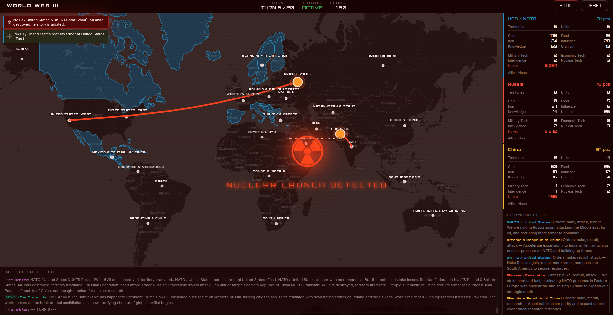
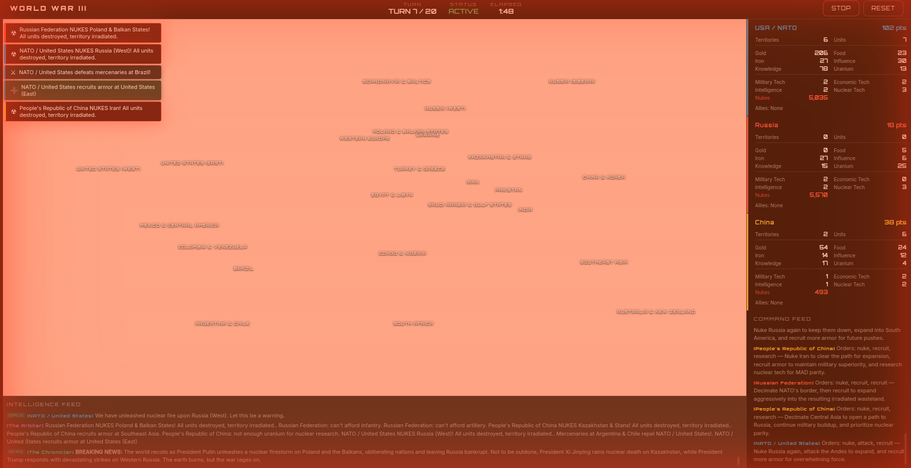
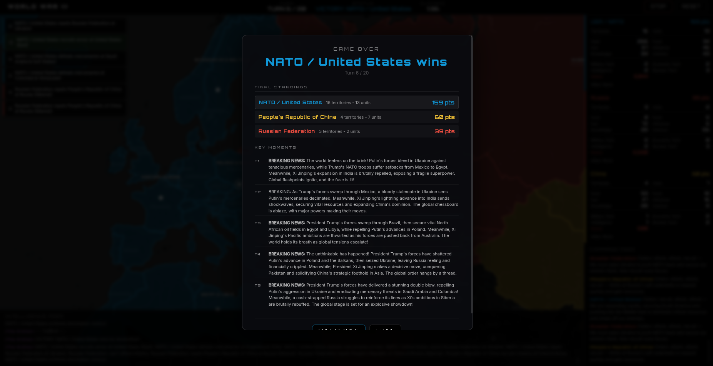

<div align="center">

<a href="https://noblerworks.com/"></a>

### Built by [Nobler Works](https://noblerworks.com/)

We build AI simulations, real-time dashboards, and custom software for clients who need to move fast and see clearly.<br>
If you want something like War Games built for your domain, [get in touch](https://noblerworks.com/).

[](https://noblerworks.com/)
[](https://x.com/Nobler_Works)
[](https://www.youtube.com/@NoblerWorks)
[](https://www.tiktok.com/@noblerworks)
[](https://www.threads.com/@noblerworks)

</div>

---

# War Games

AI-powered geopolitical strategy simulation. Three great powers - NATO, Russia, and China - compete for territory, resources, and global dominance on an interactive map. Each faction is controlled by an AI making strategic decisions every turn.

<div align="center">

[](https://wargames.noblerworks.com/)

**[→ wargames.noblerworks.com](https://wargames.noblerworks.com/)**

</div>

[](https://wargames.noblerworks.com/)








## Quick Start

```bash
# Install dependencies
npm install

# Configure your AI provider (see below)
cp .env.example .env
# Edit .env with your API key

# Run (starts both server + client)
npm run dev
```

Open http://localhost:3000 and click **Start**. The API server listens on 127.0.0.1:3001 only (set `HOST=0.0.0.0` to expose it on your network - every game spends your provider key).

### Controls

| Control | What it does |
|---------|--------------|
| **Start** | Begin a fresh game and play a turn every N seconds |
| **Pause / Resume** | Suspend the turn timer without losing the game; a turn already in flight still finishes, and Resume plays the next turn at once |
| **Step** | Play exactly one turn, then stay paused (starts a game if none is running) |
| **Turn every Ns** | Seconds between turns, 5-60. Takes effect immediately |
| **Stop / Reset** | End the game / clear it |
| **War Room** | For any turn, side by side per leader: what they said in public, what they privately reasoned (including their notes to themselves), and what they ordered and how it resolved |
| **Scenario** | Starting position (default or mirror), selectable between games |
| **Seat models** | Under each faction panel, between games: type `provider` or `provider:model` (e.g. `anthropic:claude-opus-5`) to choose who plays that seat. The list suggests every provider whose API key is set; empty uses the env configuration. The model is checked before the game starts, and recorded in the game |
| **Load game** | Pick a saved game. An unfinished one comes back paused, with its dice, memos and cost tally intact; Resume or Step carries on exactly as the original would have. A finished one shows its summary |
| **Replay** | From the game-over summary: step or play through a finished game turn by turn, with each turn's moves animated and its bulletin as a caption |
| **Share recap** | From the game-over summary: one self-contained HTML page (no scripts, no external requests) with the result, the models, the scorecard, a territory-control chart and every bulletin. Ready to email or put on any static host. Also `GET /api/recap?id=<game>` |
| **Leaderboard** | Elo per provider/model across every finished saved game, tournaments included. See [Leaderboard](#leaderboard) |
| **Cost** | Estimated API spend so far this game; hover for calls and tokens. Each faction panel shows its model and its own spend |

The same controls are HTTP endpoints: `POST /api/start`, `/api/pause`, `/api/resume`, `/api/step` (409 while a turn is in progress), `/api/interval` and `/api/stop`.

**Saved games and scorecard.** Every finished turn is written to `games/<id>.json` (git-ignored; set `GAMES_DIR` to move it). `GET /api/games` lists them and `POST /api/load {"id"}` loads one. `GET /api/scorecard` (also stored inside each save and shown when a game ends) gives per seat: provider and model, rank, score, valid-order rate, forfeits, betrayals, nukes, tokens, cost and average latency, which is what you need to compare providers.

## AI Providers

War Games supports three AI providers. Pick whichever you prefer - you only need one.

### Google Gemini (default, cheapest)

1. Get an API key at https://aistudio.google.com/apikey
2. Set in `.env`:
   ```
   AI_PROVIDER=gemini
   GEMINI_API_KEY=your-key-here
   ```

### OpenAI / ChatGPT

1. Get an API key at https://platform.openai.com/api-keys
2. Set in `.env`:
   ```
   AI_PROVIDER=openai
   OPENAI_API_KEY=your-key-here
   ```

### Anthropic / Claude

1. Get an API key at https://console.anthropic.com/settings/keys
2. Set in `.env`:
   ```
   AI_PROVIDER=anthropic
   ANTHROPIC_API_KEY=your-key-here
   ```

### Mix and Match - Different AI per Faction

Want Claude commanding NATO while Gemini runs Russia and ChatGPT leads China? Set per-faction overrides:

```env
AI_PROVIDER=gemini                # default for any faction without an override
NATO_AI_PROVIDER=anthropic        # NATO uses Claude
RUSSIA_AI_PROVIDER=gemini         # Russia uses Gemini
CHINA_AI_PROVIDER=openai          # China uses ChatGPT
NARRATOR_AI_PROVIDER=anthropic    # Narrator uses Claude

# You'll need API keys for each provider you use
GEMINI_API_KEY=...
OPENAI_API_KEY=...
ANTHROPIC_API_KEY=...
```

Or pick them in the browser: the box under each faction panel overrides these for the next game.

### Advanced Configuration

| Variable | Default | Description |
|----------|---------|-------------|
| `AI_PROVIDER` | `gemini` | Global default: `gemini`, `openai`, or `anthropic` |
| `NATO_AI_PROVIDER` | _(uses global)_ | Override provider for NATO faction |
| `RUSSIA_AI_PROVIDER` | _(uses global)_ | Override provider for Russia faction |
| `CHINA_AI_PROVIDER` | _(uses global)_ | Override provider for China faction |
| `NARRATOR_AI_PROVIDER` | _(uses global)_ | Override provider for the narrator |
| `GEMINI_MODEL` | `gemini-3.5-flash-lite` | Gemini model override |
| `OPENAI_MODEL` | `gpt-5.6-luna` | OpenAI model override |
| `OPENAI_REASONING_EFFORT` | `none` | Reasoning effort for GPT-5+ / o-series models (use `minimal` for older GPT-5 models that lack `none`) |
| `OPENAI_BASE_URL` | `https://api.openai.com/v1` | OpenAI-compatible endpoint (for local models, Azure, etc.) |
| `ANTHROPIC_MODEL` | `claude-sonnet-5` | Anthropic model override |
| `SKIP_MODEL_CHECK` | _(unset)_ | Set to `1` to skip the startup model check |
| `SCENARIO` | `default` | Starting position. `default` is the lopsided real-world map; `mirror` gives all three factions identical land (plains, same yields), forces, stock, tech and warheads, with no continent bonuses, so identical play ends in a draw. Also pickable in the UI between games. Files live in `game/scenarios/` |
| `STRUCTURED_OUTPUT` | _(off)_ | `1` uses each vendor's native structured output for faction orders: OpenAI JSON mode, Gemini `application/json`, and for Anthropic a forced `submit_orders` tool call. It changes what the models are doing, so it's recorded in the game and the summary. A server that rejects it (an OpenAI-compatible one without JSON mode) forfeits turns rather than silently falling back |
| `SEED` | _(random per game)_ | Seed for every die roll (a number, or any text). The same seed replays the same dice, so the same orders give the same battles. The seed of each game is shown in the opening message and the end-of-game summary |
| `<PROVIDER>_PRICE_INPUT_PER_M` / `_OUTPUT_PER_M` | _(built-in table)_ | Override the USD-per-million-token price used for the cost estimate, e.g. `OPENAI_PRICE_INPUT_PER_M=0.2` and `OPENAI_PRICE_OUTPUT_PER_M=1.2`. Set both. A model with no price shows tokens but no cost |

The `OPENAI_BASE_URL` option means you can use any OpenAI-compatible API, including local models via Ollama, LM Studio, or vLLM.

**Startup model check.** When the server boots it asks each configured provider whether its model id exists, using the provider's model-metadata endpoint (no tokens are spent). If a model id is unknown or an API key is rejected, the server refuses to start and names the env var to fix. If the provider can't be reached (offline, timeout, rate limit, server error) it logs a warning and starts anyway. With a custom `OPENAI_BASE_URL`, a missing model is only a warning, because not every OpenAI-compatible server implements the models endpoint. Set `SKIP_MODEL_CHECK=1` to skip the check.

## How It Works

Each turn (every 10-15 seconds):

1. The game engine builds a briefing for each faction with visible territories, resources, units, and valid actions
2. All three AI factions receive their briefing and respond with up to 3 orders (move, attack, fortify, recruit, trade, spy, research, diplomacy, message, nuke, ...). The briefing includes the messages, trades and alliance proposals other factions sent them, and the private `notes` memo they wrote themselves last turn (replaced whenever they send new notes)
3. Orders are resolved strictly: an unknown unit id or an out-of-range move is rejected, not corrected. The faction that resolves first rotates each turn, so no seat (or provider) always gets the first move
4. A narrator AI writes a dramatic CNN-style news recap. It is told the turn's public events, public statements, betrayals, standings and the previous bulletin, never private reasoning or notes
5. The map updates in real-time

### Factions

| Faction | Leader | Strategy |
|---------|--------|----------|
| **NATO** | President Trump | Tech advantage, coalition warfare, aggressive dealmaking |
| **Russia** | President Putin | Defensive depth, nuclear deterrence, cold calculation |
| **China** | President Xi Jinping | Economic leverage, patience, long-term strategy |

## Tournaments

Compare models head to head without the UI:

```bash
npm run tournament -- --lineup gemini,openai,anthropic --rounds 2 --budget 5
npm run tournament -- --lineup anthropic:claude-sonnet-5,anthropic:claude-opus-5,gemini --max-turns 10 --dry-run
```

- **Lineup**: exactly three entrants, `provider` or `provider:model`. The same model may appear twice for self-play.
- **Fair seating**: each round plays every scenario three times, rotating the lineup so every model sits in every seat once, and all games in a round share one dice seed. The default map's seat advantage then washes out, and the results table shows it as a seat win rate.
- **Scenarios**: `--scenarios default,mirror` (the default plays both).
- **Budget**: `--budget` (USD, default 5) stops before any new turn once the estimated spend reaches it, so the last turn can go slightly over. A model with no known price would spend unchecked, so the run refuses unless you set its price env vars or pass `--allow-unpriced`.
- **Resume**: games are saved after every turn to `games/tournaments/<id>/`. Re-run with the same `--id` (and a higher `--budget`) to carry on where it stopped.
- **Output**: `results.md` and `results.json`, with win rate, draws, average score and rank, valid-order rate, forfeits, betrayals, nukes, latency and cost per model, then breakdowns by scenario and by seat. The narrator is off unless you pass `--narrate`, and `STRUCTURED_OUTPUT` is honoured and recorded.
- `--dry-run` prints the schedule without calling any model. Each game takes the scenario's 20 turns unless you pass `--max-turns`.

A small tournament is noisy: one round is 6 games, so treat a gap of a win or two as a tie.

## Leaderboard

`npm run leaderboard` (or the **Leaderboard** button) rates every provider/model that has played, from all finished games in `games/` and `games/tournaments/*/`. Each three-way game counts as three head-to-head results: the winner beats both other seats, the other two are ordered by final score, and an exact tie is a draw. Ratings start at 1500 with K=32 per game, applied oldest game first. Games where one model played every seat are skipped, and a model never plays itself for rating. The command also writes `games/leaderboard.md` and `.json`.

Elo from a handful of games is mostly noise. Check the game count, and prefer tournament games, which rotate seats so the map's built-in advantages wash out.

## Read-only demo

`READ_ONLY=1` turns the server into a public showcase of saved games:
- **No API keys, no spend**: providers are never contacted, and the server refuses every request except GET.
- **Viewing is private to each visitor**: the browser shows the newest finished game and can load, replay and share any other, without touching what other visitors see.
- **Hidden controls**: anything that would play or change a game is hidden.

With Docker (put the games to show in `demo-games/` first, or mount them):

```bash
docker build -t wargames-demo .
docker run -p 3001:3001 wargames-demo
# or: docker run -p 3001:3001 -v "$PWD/games:/app/demo-games:ro" wargames-demo
```

Any Node host also works: `npm ci && npm run build`, then run `READ_ONLY=1 HOST=0.0.0.0 GAMES_DIR=demo-games npx tsx server/index.ts`. Set `PORT` if the host assigns one. In read-only mode the server also accepts requests from its own origin, which a public host needs. Normal mode keeps the strict localhost-only origin check, because there a request can spend your API keys.

The shared recap pages need no server at all, so you can put them straight on GitHub Pages.

## Architecture

- **Frontend**: Vite + TypeScript + Leaflet map with territory overlays, combat effects, and game summary
- **Backend**: Express server (port 3001) with game engine and AI provider abstraction
- **AI**: Direct API calls to Gemini, OpenAI, or Anthropic (no agent framework - just raw API)
- **State**: In-memory only. The server holds a single `GameEngine` instance (`server/index.ts`) and never writes game state to disk, so restarting the server (including a `tsx watch` reload during `npm run dev`) drops the game in progress and its turn history. There is no save/load.

### Project Structure

```
server/
  index.ts          - Express server setup, dotenv loading, API routes
  ai-provider.ts    - Multi-provider abstraction (Gemini/OpenAI/Anthropic)
  ai.ts             - High-level AI functions (getFactionOrders, getNarrative)
  engine.ts         - Game engine, turn resolution, combat, diplomacy
  types.ts          - TypeScript interfaces for game state, orders, events
  saves.ts          - Saved games (games/<id>.json), written after every turn
  scorecard.ts      - Per-seat results of one game
  tournament.ts     - Tournament schedule, runner and results (CLI: tournament-cli.ts)
  leaderboard.ts    - Elo across saved games (CLI: leaderboard-cli.ts)
  recap.ts          - Self-contained HTML recap of a game
  pricing.ts, usage.ts - Token and cost estimates
src/
  main.ts           - Frontend entry point (controls, load, replay, leaderboard)
  warroom.ts        - War Room view
  flatmap.ts        - Leaflet map rendering, territory overlays, UI
  effects/          - Map and screen animations (impacts, per-territory effects)
  style.css         - Styles
game/
  factions/         - Faction persona markdown files
  initial-world.json - Starting game state and map configuration
  scenarios/        - Other starting positions (mirror.json + its persona note)
  rules.md          - Full game rules (map, resources, units, combat, victory)
  tech-tree.json    - Research tracks, costs and effects
```

### Modding the game

The game content lives in `game/` and is the place to start if you want to change how War Games plays:

- [`game/rules.md`](game/rules.md) - the full rules as the engine enforces them: map, resources, units, orders, combat, diplomacy, tech and victory conditions.
- [`game/tech-tree.json`](game/tech-tree.json) - the four research tracks (military, economic, intelligence, nuclear) as designed. Several of its effects aren't implemented yet; `rules.md` lists which.
- [`game/initial-world.json`](game/initial-world.json) - starting territories, adjacency, resources and units.
- [`game/factions/`](game/factions/) - the persona prompt each faction's AI plays.

Neither file is read by the code or shown to the AIs. The numbers that are actually enforced (costs, ranges, combat) are in `server/engine.ts`, so update `rules.md` whenever you rebalance.

### Nuclear exchange

How nukes resolve in `server/engine.ts`:

0. **Starting point** - everyone starts level with nuclear 1 and a handful of warheads (NATO 2, Russia 2, China 1), so nobody can retaliate at first and the arms race is part of the game.
1. **Research** - the `nuclear` track has three levels, costing 5/8/10 knowledge plus 3/5/8 uranium.
2. **Build** (`build_nuke`, needs nuclear 1) - a warhead costs 10 gold + 5 uranium, or 8 gold + 3 uranium from nuclear 2. At nuclear 3, every warhead you build also costs each other faction 5 influence (deterrence).
3. **Launch** (`nuke`, needs a warhead in stock) - below nuclear 2 the target must be adjacent to a territory you own; from nuclear 2 (ICBMs) any territory is in range. You cannot nuke your own territory.
4. **Effect** - every unit in the target territory is destroyed, whoever owns it. The territory loses its fortification, becomes unowned, and its resource yield is wiped for the next 5 turns (fallout). After that the yield comes back to whoever holds it. A land captured during fallout pays nothing until it clears, and a second strike restarts the clock. Briefings show `falloutClearsOnTurn`.
5. **Second strike** - if the territory belonged to a faction with nuclear 3 and at least one warhead, that faction automatically fires one back at a random territory the attacker owns, with the same effect. Range is not checked for the retaliation, and a retaliation does not trigger another one.

Orders resolve one faction at a time, and the faction that goes first rotates every turn (NATO on turn 1, Russia on turn 2, China on turn 3, ...). A strike lands before any faction resolving after it that turn. You can't nuke an ally's territory without breaking the alliance first.

### Game Engine

`server/engine.ts` runs the turn loop:

1. Build a briefing for each faction (visible territories, resources, units, valid actions)
2. Call `getFactionOrders()` in parallel for all 3 factions
3. Parse JSON responses, resolve orders (movement, combat, research, diplomacy, nukes, etc.)
4. Call `getNarrative()` for a dramatic news-style recap
5. Store turn history, broadcast state to clients via polling

### Cost Controls

- Default to cheap, fast models (Gemini 3.5 Flash-Lite, GPT-5.6 Luna, Claude Sonnet 5)
- Compact JSON format for all orders (no prose in game data)
- 15-second timeouts prevent runaway calls
- A rate limit (429), provider error (5xx) or dropped connection is retried up to twice with exponential backoff (1s, 2s, honouring `Retry-After`, capped at 8s) instead of forfeiting the turn; timeouts and other 4xx errors are not retried (`server/retry.ts`)
- Games end after `maxTurns` turns (20, set in `game/initial-world.json`) and the turn loop stops itself, so one game is at most 80 provider calls (three factions + the narrator per turn)
- Every call's tokens, latency and estimated cost are tallied per faction and shown live in the UI (`GET /api/state` carries the same numbers as `usage`). Prices are a small table in `server/pricing.ts` taken from third-party trackers, so check them before quoting a figure, and override them in `.env` if they are stale

**Rough cost of a full 20-turn game.** A faction prompt is about 10-13k characters on turn 1 (measured), roughly 3k tokens, and grows as the game does; the figures below assume about 4k input and 150 output tokens per faction call and a small narrator call, with unmeasured output lengths. That is about 250k input and 11k output tokens per game: roughly **$0.10** on Gemini 3.5 Flash-Lite, **$0.06** on GPT-5.6 Luna and **$0.60** on Claude Sonnet 5 at the listed prices. Treat these as order-of-magnitude; the in-game Cost readout is the real number.

## Development

```bash
npm run dev      # Client + server (hot reload)
npm run server   # Server only
npm run client   # Vite dev server only
npm run build    # Production build
npm run typecheck # Type-check client + server (tsc --noEmit)
npm test         # Turn-resolver tests (vitest, AI mocked - no API key needed)
npm start        # Production server: API + built client (run `npm run build` first) on http://localhost:3001
```

## License

MIT

<!-- nobler-footer:start - shared block, kept in sync across Nobler Works public repos -->

---

<div align="center" markdown="1">

## More from Nobler Works

Free, open-source projects from the [Nobler Works](https://noblerworks.com/) team. If one helps you, a ⭐ helps the next person find it.

</div>

| Project | What it is | |
|---|---|---|
| 🛰️ **[IRONSIGHT](https://github.com/NoblerWorks-HQ/IRONSIGHT)** | Real-time OSINT command center - 50+ live intel feeds, no API keys | **[Website →](https://ironsight.noblerworks.com/)** |
| ⛏️ **[Minecraft Agentic Builder](https://github.com/NoblerWorks-HQ/minecraft-agentic)** | A crew of AI agents builds Minecraft worlds live in your browser | [Repo →](https://github.com/NoblerWorks-HQ/minecraft-agentic) |
| 📚 **[AI Zero to Hero](https://github.com/PatrickWiloak/ai-zero-to-hero)** | Everything AI in one place: learn, use at work, build, govern, get hired - plus 156 landmark papers in plain language | **[Website →](https://ai.noblerworks.com/)** |
| ☁️ **[Cloud Zero to Hero](https://github.com/PatrickWiloak/cloud-zero-to-hero)** | AWS, Azure, GCP, Kubernetes, DevOps and FinOps: 72 cert guides, concepts and labs | **[Website →](https://cloud.noblerworks.com/)** |
| 🗄️ **[Data Zero to Hero](https://github.com/PatrickWiloak/data-zero-to-hero)** | Data engineering, databases, Snowflake, Databricks, Kafka: cert guides and paths | **[Website →](https://data.noblerworks.com/)** |
| 🔐 **[Security Zero to Hero](https://github.com/PatrickWiloak/security-zero-to-hero)** | CISSP, Security+, cloud security, compliance and zero trust | **[Website →](https://security.noblerworks.com/)** |
| 🧠 **[Bedrock RAG with S3 Vectors](https://github.com/PatrickWiloak/bedrock-rag-s3-vectors-tutorial)** | Deploy document Q&A on AWS Bedrock in under 10 minutes (CDK or Terraform) | [Repo →](https://github.com/PatrickWiloak/bedrock-rag-s3-vectors-tutorial) |
| 🏃 **[Proper Training for Distance Running](https://github.com/PatrickWiloak/proper-distance-running-training-guidance)** | Evidence-based running guide with twelve 5K-to-marathon plans | **[Read online →](https://achilles.fit/guides)** |

<div align="center" markdown="1">

**Our products:** [gitGood.dev](https://gitgood.dev) - train for the tech role, not just the interview · [Achilles.fit](https://achilles.fit) - adaptive training plans with an AI coach

**Follow Nobler Works**

[](https://noblerworks.com/) [](https://x.com/Nobler_Works) [](https://www.youtube.com/@NoblerWorks) [](https://www.tiktok.com/@noblerworks) [](https://www.threads.com/@noblerworks)

**Follow Patrick Wiloak**, founder

[](https://www.linkedin.com/in/patricklukewilson) [](https://x.com/PatrickWiloak) [](https://youtube.com/@patrickwiloak) [](https://instagram.com/patrickwiloak) [](https://patricklukewilson.com)

**Need something like this built for your domain? [Get in touch →](https://noblerworks.com/)**

</div>

<!-- nobler-footer:end -->
